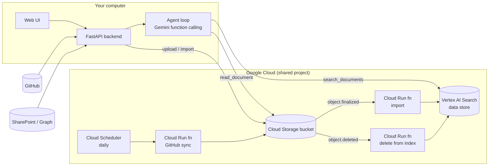

# Project Knowledge AI

**A private, tool-using knowledge agent on Google Cloud.** Drop documents, paste a GitHub repository or connect a SharePoint site; the agent searches them, reads the relevant passages, answers in your language with clickable sources, and asks before it changes anything.


---

## What it does

| | |
|---|---|
| **Ask anything about your documents** | The agent decides how to answer: it searches, reads full passages when snippets are not enough, searches again with different wording, and cites every source with a link. Follow-up questions keep the conversation context. |
| **Bring documents from anywhere** | Drag-and-drop files (PDF, DOCX, PPTX, XLSX, TXT, MD, HTML, JSON), import a public GitHub repository from its URL, or connect a SharePoint Online site. Everything is indexed automatically and kept in sync: changed files are re-indexed, removed files disappear from the index. |
| **Safe by construction** | Actions that modify data (import, re-sync) stop and ask for confirmation in the UI. Document content is treated as untrusted data. The agent can only read the knowledge-base bucket. Nothing is exposed publicly; no service-account keys exist anywhere. |
| **Honest about limits** | Generous rate limits protect the shared cloud budget and warn before they block. Every answer shows *what the agent did*. |

Works on desktop and phone, light and dark.

## How it works



**The agent** (`backend/agent.py`) is a bounded loop over Gemini function calling. The model picks tools, observes results and continues until it can answer, within 6 steps:

| Tool | Kind | What it does |
|---|---|---|
| `search_documents(query)` | read | Vertex AI Search query; stale results whose file no longer exists are dropped. |
| `read_document(uri, focus)` | read | Reads the object from the bucket and returns the passages matching `focus`. |
| `list_documents()` | read | What exists, its status, size and last update. |
| `github_repository_status(owner, repo)` | read | Per-file status of an imported repository. |
| `import_github_repository(url)` | **action** | Imports a public repository's README and `docs/**/*.md`. |
| `sync_github_repositories()` | **action** | Re-imports every imported repository. |
| `import_sharepoint_site(url)` | **action** | Imports a SharePoint site (shown only when configured). |

Read tools run immediately. **Action** tools never run on the model's say-so: the loop stops, the UI shows *Action required* with Confirm/Cancel, and only on Confirm is the question re-sent with the approval and the tool executed.

**Ingestion** is event-driven and keyless. A file reaching the bucket fires `object.finalized` → an incremental `ImportDocuments`; deleting it fires `object.deleted` → the document is removed from the index (overwrites are detected and skipped). GitHub and SharePoint imports compare content hashes, so unchanged files cost nothing and removed files are mirrored. A Cloud Scheduler job re-syncs repositories daily.

## Engineering notes — things that were not in the docs

A few findings from building this that may save someone a day:

- **Vertex AI Search (Discovery Engine) ignores IAM conditions.** A `roles/discoveryengine.editor` binding scoped with `resource.name.startsWith(...)` is silently ineffective and imports fail with `PERMISSION_DENIED`. The fix is an unconditional custom role with only `documents.import/list/delete` and `operations.get`.
- **Cloud Run invoker must be granted on the service.** A project-level `roles/run.invoker` conditioned on the service's resource name does not match, so Eventarc deliveries get 401 forever while the function looks healthy.
- **The serving index lags deletions by hours.** `delete_document` succeeds and `list_documents` agrees, yet search keeps returning the deleted file with its snippets. The bucket is the source of truth: results whose object is gone are filtered out.
- **The Standard edition only returns snippets.** Extractive segments/answers need Enterprise. Reading the retrieved objects from the bucket and selecting passages by term overlap turned "the context does not say" into correct, complete answers at zero extra cloud cost.
- **An overwrite emits a delete.** Re-uploading a file sends `object.deleted` for the previous generation; a naive delete trigger would remove what was just re-indexed.

## Run it locally

Requirements: Windows PowerShell, Git, Python 3.10+ and the Google Cloud CLI (`gcloud`). You need read access to this repository and the IAM roles below on the GCP project; repository access alone grants nothing in GCP.

```powershell
git clone https://github.com/AngelUch27/project-knowledge-ai.git
Set-Location project-knowledge-ai
py -m venv .venv
.\.venv\Scripts\python.exe -m pip install -r backend\requirements.txt
Copy-Item .env.example .env
```

`.env.example` contains the demo project and resource IDs only (no credentials). `.env` is git-ignored; never put keys in it beyond the optional SharePoint secret described below.

Authenticate with **your own account** (Application Default Credentials). The GCP administrator must have granted you `roles/discoveryengine.user`, `roles/aiplatform.user` and `roles/storage.objectUser`:

```powershell
gcloud auth login
gcloud config set project geglobal-level-program
gcloud auth application-default login
```

Start the app and open <http://127.0.0.1:8000>:

```powershell
.\.venv\Scripts\python.exe -m uvicorn backend.main:app --host 127.0.0.1 --port 8000
```

The server binds to `127.0.0.1` only, validates the `Host` header and rejects other origins; the API is not reachable from other machines. Keep it that way for the demo. To publish it, use Cloud Run behind IAM/IAP with an attached runtime service account; never deploy it unauthenticated.

Run the tests:

```powershell
.\.venv\Scripts\python.exe -m pip install -r requirements-dev.txt
.\.venv\Scripts\python.exe -m pytest tests -q
```

### Optional: SharePoint

Ask your tenant administrator for an Entra ID app registration with the *application* permission `Sites.Read.All` (or `Sites.Selected` granted on the sites you need) and admin consent. Put the three values in `.env` and restart:

```
SHAREPOINT_TENANT_ID=...
SHAREPOINT_CLIENT_ID=...
SHAREPOINT_CLIENT_SECRET=...
```

Until then the SharePoint panel and the agent tool stay hidden. Limits: 200 files, 15 MB per file, 100 MB per import; downloads are accepted from `*.sharepoint.com` only.

## Publish it for your team (Cloud Run + IAP)

To use the app from any device with a link, publish it on Cloud Run behind **Identity-Aware Proxy**: the URL is public, but Google asks for a sign-in and only the accounts you allow get through. The container runs as a key-less service account with the same three roles a human user needs, scales to zero, and costs nothing while idle.

```powershell
.\scripts\deploy-app.ps1                                   # allows every @capgemini.com account
.\scripts\deploy-app.ps1 -AllowedMembers "user:ana@example.com","user:luis@example.com"
```

The script enables the APIs, creates the `knowledge-agent-app` service account, builds the image from the `Dockerfile` with Cloud Build, deploys `knowledge-agent` with `--no-allow-unauthenticated --iap`, lets the IAP service agent invoke it, grants `roles/iap.httpsResourceAccessor` to the allowed members and prints the URL. Re-run it to deploy a new version. Inside the container `ALLOWED_HOSTS=*.run.app` replaces the loopback-only host check, the same-origin check honours `X-Forwarded-Proto`, rate limits are per signed-in user (`X-Goog-Authenticated-User-Email`) and the top bar shows who is signed in. SharePoint credentials, if you use them, belong in Secret Manager (`--set-secrets`), not in `--set-env-vars`.

## Deploy the cloud side

Run once per project from the repository root; the deploying account needs to manage IAM, enable services and deploy Cloud Run functions and Eventarc (`roles/run.sourceDeveloper`, `roles/serviceusage.serviceUsageConsumer`, `roles/iam.serviceAccountUser` on the runtime service account, plus the ability to create service accounts and custom roles). A project administrator can run this with their own account.

```powershell
gcloud auth login
gcloud config set project geglobal-level-program
$project = "geglobal-level-program"
$serviceAccount = "knowledge-agent-ingest@$project.iam.gserviceaccount.com"
$activeAccount = (gcloud auth list --filter="status:ACTIVE" --format="value(account)").Trim()
gcloud iam service-accounts describe $serviceAccount --project $project *> $null
if ($LASTEXITCODE -ne 0) {
    gcloud iam service-accounts create knowledge-agent-ingest --project $project --display-name "Knowledge Agent document ingestion"
}
gcloud iam service-accounts add-iam-policy-binding $serviceAccount --member="user:$activeAccount" --role="roles/iam.serviceAccountUser" --project $project
.\scripts\deploy-ingestion.ps1
gcloud functions describe knowledge-agent-gcs-import --gen2 --region us-central1 --project $project --format="value(state)"
```

The script is idempotent. It enables the APIs, creates the service account and two least-privilege custom roles, grants bucket access, deploys the three functions (`knowledge-agent-gcs-import`, `knowledge-agent-gcs-delete`, `knowledge-agent-github-sync`) with a key-less runtime identity, grants invoker on each service, and creates or updates the Cloud Scheduler job (`-SyncSchedule`, `-SyncTimeZone` to change the default 06:00 America/Mexico_City). If your organization policy requires it, an administrator must also grant `roles/run.builder` to the Cloud Build service account.

Objects that existed before the trigger was created do not produce retroactive events; re-upload them (or rewrite them in place) to index them.

## API

All routes are local-only. Imports, uploads and questions are rate-limited (see below).

| Route | Purpose |
|---|---|
| `GET /health` | Local health; no GCP call. |
| `POST /ask` | Runs the agent. Body: `question`, optional `history` (previous turns, up to 20) and `approved_actions`. Returns `answer`, `sources` (with `url`), `steps`, `pending_action`/`pending_description` when confirmation is needed, and `usage` of the question budget. |
| `POST /search` | Raw Vertex AI Search query (5 results with snippets). |
| `GET /documents` · `POST /documents` | List bucket files with ingestion status · upload one file (≤ 15 MB). |
| `GET /documents/file?uri=gs://…` | Serves one object of the configured bucket to the browser (citation links). |
| `POST /github/repositories` · `POST /github/repositories/sync` · `GET /github/repositories/{owner}/{repo}/status` | Import a public repository · re-import every imported repository · per-file status. |
| `GET /sharepoint/config` · `POST /sharepoint/sites` | Whether SharePoint is configured · import a site. |
| `GET /usage` | Current consumption of every rate-limit policy. |
| `/docs` | Interactive OpenAPI documentation. |

**Rate limits** (per client, sliding windows; override with the `RATE_LIMIT_*` variables in `.env`): questions 60/min and 1,000/h, searches 300/min, imports and syncs 60/h, uploads 100/min and 1,000/h. They are deliberately wide: their job is to stop a runaway script or an obvious attack, not a room of people demoing from one machine. Responses carry `X-RateLimit-*` headers; from 80 % the UI shows a heads-up and the server logs a warning; over the limit the API answers `429` with `Retry-After`. Agent-triggered imports count against the same budget.

**Configuration** (`.env`): `GCP_PROJECT_ID`, `GCP_LOCATION`, `GCS_BUCKET`, `GEMINI_MODEL`, `AGENT_SEARCH_LOCATION`, `AGENT_SEARCH_APP_ID`, `AGENT_SEARCH_SERVING_CONFIG`, `AGENT_SEARCH_DATA_STORE_ID`, optional `SHAREPOINT_*` and `RATE_LIMIT_*`. Authentication is always Application Default Credentials; there are no keys to leak. Searches, imports and Gemini calls incur charges in the shared project.

## Project layout

```
backend/
  main.py              FastAPI app, routes, tool definitions, rate-limit wiring
  agent.py             bounded tool-calling loop with confirmed actions
  passages.py          text extraction (PDF/DOCX/PPTX/XLSX/…) and passage selection
  github_import.py     GitHub import with change detection and removal mirroring
  sharepoint_import.py SharePoint import through Microsoft Graph
  ratelimit.py         sliding-window limiter with early warnings
frontend/index.html    the web UI (no build step)
ingestion/main.py      Cloud Run functions: import, delete-from-index, scheduled sync
scripts/deploy-ingestion.ps1  idempotent cloud deployment
tests/                 77 pytest cases (agent loop, approvals, imports, limiter, API guards)
```

## Roadmap

- Evaluation set (question → expected answer) to measure answer quality across changes.
- Read source code from repositories, not only Markdown.
- Deploy the app itself to Cloud Run behind IAP for team use.
- Enterprise edition of Vertex AI Search to replace the custom passage selection with native extractive answers.

---

Built by [Angel](https://github.com/AngelUch27) as a Capgemini project, with a focus on making an LLM agent that is useful, auditable and cheap to run.
